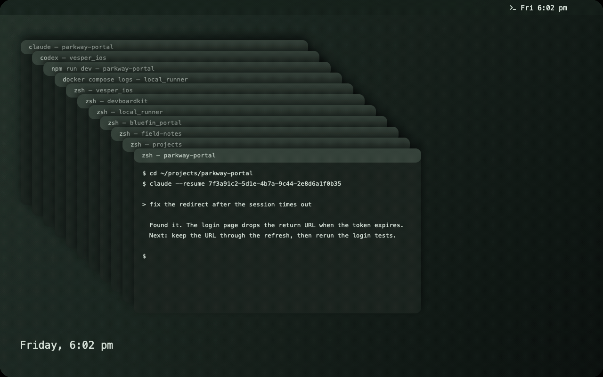
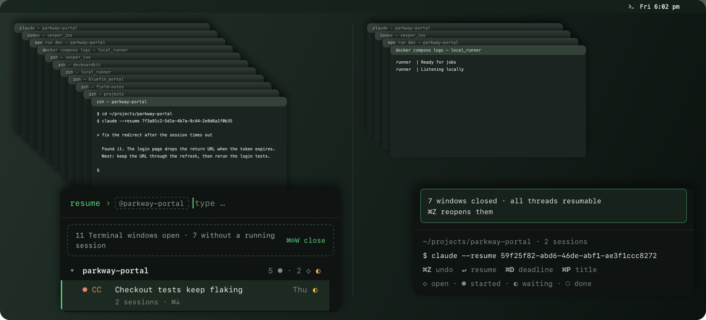
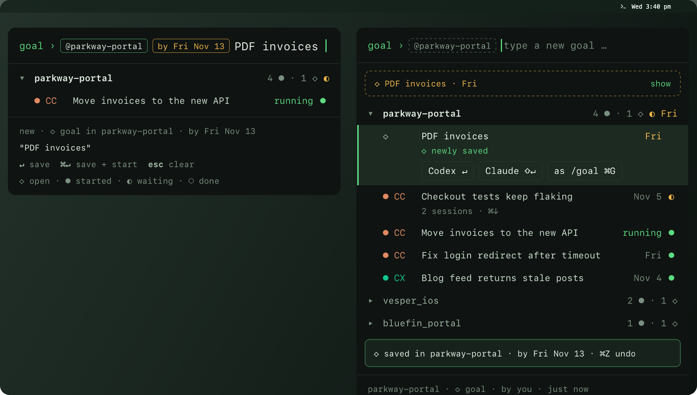
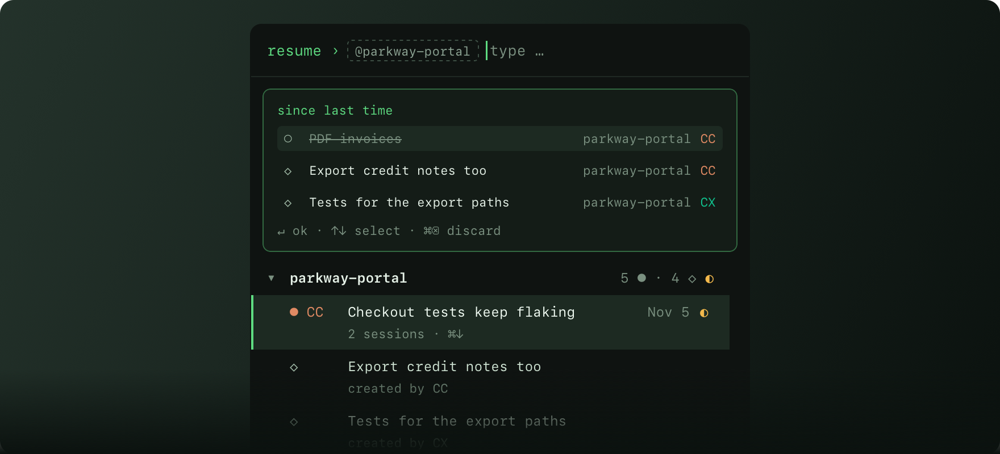
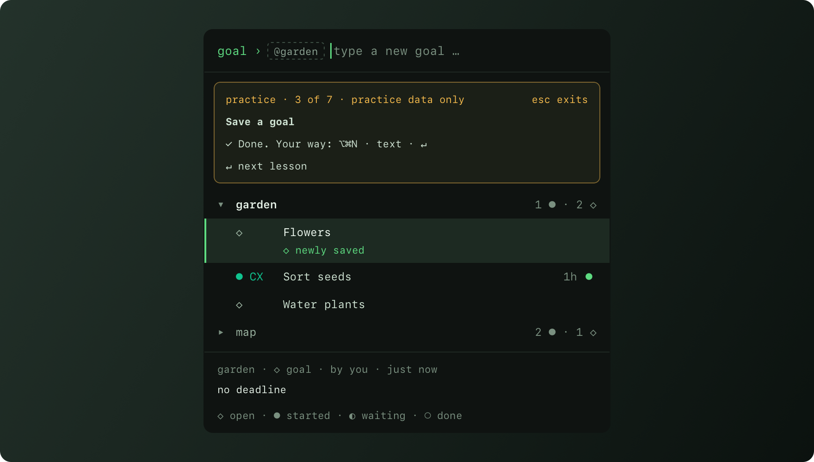
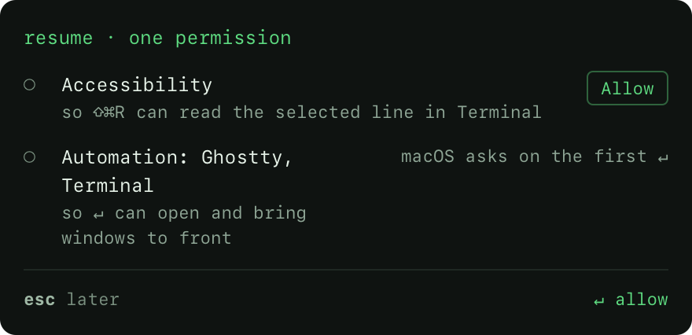
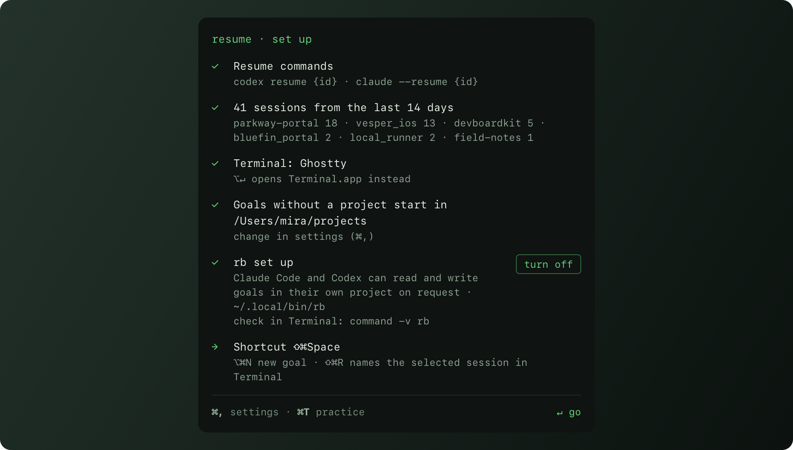

# Resume Bar

### Close the window. Keep the thread.

Resume Bar lives in your Mac's menu bar and remembers your Claude Code and Codex sessions. It files each one under its project, and one key takes you back.



**[Download for Mac](https://github.com/porco-rs/resume-bar/releases)** · free and open source · everything stays on your Mac

Needs macOS 26 or later on Apple silicon, Claude Code or Codex, and Ghostty or Terminal.

<!-- Delete this note on release day. -->
> The first signed release isn't out yet. Choose **Watch → Custom → Releases** at the top of this page and GitHub tells you when it lands, or [build it yourself](#build-it-yourself) today.

---

It's Friday, 6 pm. Eleven terminal windows are open, and you don't dare close any of them, because one of them holds the conversation about the login bug. You just couldn't say which.

On Monday you press `⇧⌘Space`, type `log`, and press `↵`. A window opens in the right folder, and the conversation is right where you left it.

You never had to know where it was.

That's the whole idea. Resume Bar works like a phone book: nobody memorizes the numbers, you look up the name. Terminal windows come and go. The app keeps the memory, so your head doesn't have to, and neither do eleven windows.

## What you get back

### Your place, in one key

`⇧⌘Space` works from anywhere and opens in under 100 ms, so you won't lose the thought on the way. Resume Bar shows the project of your front terminal first, and what you want is often already selected. If it isn't, a few letters will do: `pp blog` finds the blog thread in `parkway-portal`.

`↵` picks the work back up in a new window, in the right folder. If the session is still running, `↵` brings its window to the front instead, with no second instance.

There's nothing to set up and nothing to tag. A new session turns up on its own, whichever tool you started it with. Claude Code and Codex share one list, and a **thread** is one line of work that can hold several sessions, even from both tools. `⌘↓` shows them.

### A desk you can clear

Windows pile up. Resume Bar notices, and tells you how many of them are just sitting there.



`⌘⇧W` closes only windows where every tab is an idle shell and no session is running. Anything with a process in it stays open. Changed your mind? `⌘Z` reopens them in the same folders.

Go home on Friday with a clean desk. Your threads stay on the list, ready to resume.

### Goals: prompts you haven't sent yet

You're in the middle of one thing when you think of another. Press `⌥⌘N`, type `PDF invoices by fri`, and press `↵`. The thought is filed under its project, and `esc` puts you back where you were.



When you're ready, `↵` starts a session in that project with your text as the prompt. `⇧↵` uses the other tool, `⌘G` first makes it a `/goal`, and `⌘↵` saves and starts in one go.

Deadlines understand `by fri`, `by tomorrow`, and `by 2026-11-14`. As one gets close, a line at the top of the list turns yellow, then red. Once a goal is overdue, the menu bar icon gets a dot.

### Notes from your agent

Ask a session to remember something for you: *"Use `rb` to add that as a goal."* The next time you open Resume Bar, it's waiting under *since last time*. `↵` accepts, `⌘⌫` discards.



Agents get three commands, `ls`, `add`, and `done`, only when you ask and only in their own project. The app refuses the rest. This is a guard rail against mistakes, not a security boundary: the app recognizes agents by their process, so it can't stop a program deliberately running as you.

### Keys your fingers will remember

A keyboard tool only pays off once the keys stop being something you look up. `⌘T` opens a trainer: seven short lessons and a final round, on practice data only. You'll sort seeds and water plants. A wrong key gets you "Nothing happened.", which is exactly the right amount of drama.



## Your first minute

1. **Download** the DMG from [Releases](https://github.com/porco-rs/resume-bar/releases), open it, and drag Resume Bar to Applications.

2. **Open it.** You get one optional question. **Accessibility** lets `⇧⌘R` read the line you've selected in the terminal, so you can name a thread by pointing at it. It reads that line only when you press those keys. Press `esc` to skip it, and everything else still works.

   

3. **See what it found.** You don't import anything, and there's no account. Your recent sessions are already there, sorted by project.

   

4. **Press `⇧⌘Space`, then `↵`.** The first time, macOS asks whether Resume Bar may control Ghostty or Terminal (**Automation**). Say yes. That's how it opens your session and brings windows to the front.

From then on it starts when you log in, so it's already there on Monday morning. If you'd rather it weren't, remove it under System Settings › General › Login Items & Extensions, and it stays removed.

Official releases come only from [this repository's releases](https://github.com/porco-rs/resume-bar/releases), signed by Leon Vincent Schwahn.

<details>
<summary>Check it before you trust it</summary>

Every release is a signed and notarized DMG, published with its SHA-256 checksum on the [GitHub releases](https://github.com/porco-rs/resume-bar/releases) page.

Compare the published checksum with your download:

```sh
shasum -a 256 ResumeBar.dmg
```

Inspect the installed app's signature:

```sh
codesign -dv /Applications/ResumeBar.app
```

It should show `TeamIdentifier=DLYUZB2S4C`.

</details>

## Everything stays on your Mac

Your sessions hold your code, maybe your clients' code, and the occasional thing you'd rather keep to yourself. So everything stays on your Mac, and the code makes no network calls. There's no account, and the source is right here, so you don't have to take anyone's word for it.

Here is everything Resume Bar reads, and why:

- session files below `~/.claude/projects` and `~/.codex/sessions`, and `~/.codex/session_index.jsonl`, for metadata, thread names and a title taken from the first prompt
- `~/.claude/sessions` and the processes attached to a terminal (name, path, arguments, open files of `codex`, and the one environment variable `RB_ENTRY`), to see which sessions are running
- `~/.zsh_history` once, to count past resume commands; only the counts are kept
- through Automation, the windows and working directories of Ghostty and Terminal, to bring windows to the front and suggest the project
- the selected line in the terminal, only when you press `⇧⌘R`

Because a title can come from your first prompt, your list may show a few words you typed. They stay on your Mac with everything else.

It stores its list in `~/Library/Application Support/ResumeBar/`, writes timing logs without session content to `~/Library/Logs/ResumeBar/`, and creates one link at `~/.local/bin/rb` when AI access is on. It never changes Claude Code or Codex configuration.

Your list is yours, too: `rb export` prints your data as JSON.

## The keys

You can change the global shortcuts in settings (`⌘,`).

| Anywhere | |
|---|---|
| `⇧⌘Space` | open Resume Bar |
| `⌥⌘N` | open a new goal |
| `⇧⌘R` | name a thread from the selected terminal line or the active session (while Ghostty or Terminal is in front) |

| In the list | |
|---|---|
| `↵` | resume or start |
| `⇧↵` | start with the other tool |
| `⌥↵` | use the other terminal |
| `⌘↓` | show a thread's sessions |
| `⌘⌫` | mark done |
| `⌘Z` | undo |
| `⌘/` | show all the keys |

<details>
<summary>More keys</summary>

| | |
|---|---|
| `⌘↵` | save a goal and start it now |
| `⌘G` | toggle `/goal` |
| `⌘C` | copy the resume command |
| `⌘P` | edit the title |
| `⌘D` | set a deadline; empty removes it |
| `⌘S` | status: open → waiting → done |
| `⇥` | complete a project name, or assign a project |
| `⌘⇧W` | clean up idle windows |
| `⌘T` | practice |
| `@project` `cc` `cx` `?` `!` `/a` | in the search: filter by project, tool, waiting, done, archive |

</details>

## `rb`, for your shell and your agents

AI access is on by default. Turn it off during setup or in settings, and the link goes with it. With AI access on, `rb` provides:

```text
rb ls [-a] [-p name]
rb add "text" [--bis word|--by word] [-p name]
rb start <id|text> [--cc] [-p name]
rb done [id|text] [-p name]
rb bis <id|text> <word|-> [-p name]
rb due <id|text> <word|-> [-p name]
rb export
rb --help
```

`ls` lists goals, `add` adds one, `start` starts a session, `done` marks one done, `bis` or `due` sets a deadline (`-` clears it), and `export` exports the data. AI sessions may use `ls`, `add`, and `done` only on request and only within their own project.

## Questions you may have

**I use iTerm, or Warp, or something else. Can I still use it?**
Partly. Resume Bar opens and focuses windows in Ghostty and Terminal only. It reads the tools' session files, so sessions you start elsewhere still show up, and `⌘C` copies the resume command to paste wherever you like.

**What about other agents?**
Today it knows Claude Code and Codex, and nothing else.

**What if a session's history is gone?**
Claude Code and Codex own their session files. If one goes missing, the thread stays on your list, marked `can't resume · history missing`, and `⌘⌫` marks it done.

**Can I use my own commands and aliases?**
Yes. Settings hold the command for each tool. `{id}` becomes the session ID, and the command runs in your shell, so aliases work too.

**Is this an Electron app?**
No. It's Swift with a single WKWebView for drawing, and no web framework. On the maker's Mac, opening stayed under 100 ms in five of five timed runs. At rest it used 0.9% of one core on a quiet machine and 3.4% under heavy load. That's one Mac, so treat those numbers as a sketch.

**Which languages does it speak?**
English and German. It follows your system language.

## Build it yourself

You'll need Xcode 27 and [just](https://github.com/casey/just). Run `just app` and open `build/ResumeBar.app`. Without a Developer ID certificate, the build is signed ad hoc, and macOS may ask for permissions again after a rebuild.

A Swift core holds state and renders HTML; a WKWebView displays it and reports events. The app is one SwiftPM package with no web framework. Use `just build` to build, `just test` to run tests, and `just gen` to regenerate resources.

The code is licensed under [Apache-2.0](LICENSE). See [TRADEMARKS.md](TRADEMARKS.md) for the name and icon.

## A small project, made with care

Resume Bar is a personal project, maintained when time permits. I can't promise a reply or a fix, and for now I'm not accepting pull requests ([why](CONTRIBUTING.md)). If you find a security problem, please [report it privately](SECURITY.md).

---

Now go close some windows.
